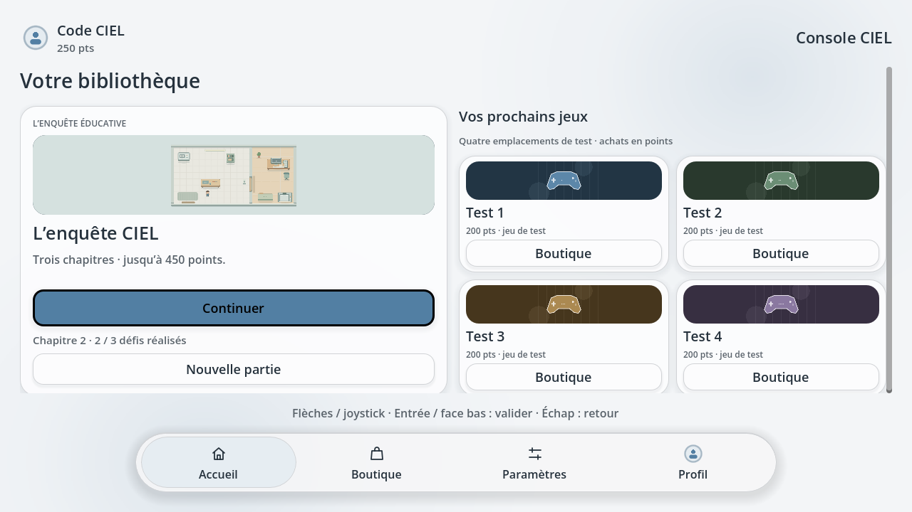

# Console CIEL

**Version 0.16.0** — Une enquête éducative et une bibliothèque de jeux, utilisables hors ligne au clavier ou à la manette.

## Télécharger pour Windows

**[Télécharger Console CIEL pour Windows 64 bits](https://github.com/loghanmrsn/Console-logiciel/raw/refs/heads/main/console-ciel/builds/Console_CIEL_Windows_x86_64_pnj_fluide_0.16.0.zip)**

1. Télécharger le ZIP et choisir **Extraire tout**.
2. Ouvrir le dossier extrait.
3. Double-cliquer sur **Console_CIEL.exe**.

Godot n’a pas besoin d’être installé pour jouer.

## Télécharger pour Linux / Raspberry Pi

**[Télécharger Console CIEL pour Raspberry Pi ARM64](https://github.com/loghanmrsn/Console-logiciel/raw/refs/heads/main/console-ciel/builds/Console_CIEL_Raspberry_Pi_ARM64_0.16.0.zip)**

Cette version est prévue pour un **Raspberry Pi 4 avec Raspberry Pi OS 64 bits et bureau**.

1. Télécharger et extraire tout le ZIP.
2. Ouvrir un terminal dans le dossier extrait.
3. Lancer le logiciel :

```bash
bash ./Lancer_Console_CIEL.sh
```

Pour ajouter un raccourci au menu du bureau : `bash ./Installer_raccourci.sh`. Godot n’a pas besoin d’être installé. Ce paquet ARM64 est destiné au Raspberry Pi ; il ne convient pas aux PC Linux x86_64.

## Présentation du logiciel

Console CIEL permet d’apprendre en explorant un atelier, une salle réseau et un espace consacré au code et un laboratoire réseau. Le joueur résout des pannes simulées, gagne des points et personnalise son profil. Tout fonctionne localement, sans compte en ligne ni paiement réel.



### L’enquête éducative

L’enquête comprend **cinq chapitres et treize missions** :

| Chapitre | Missions |
|---|---|
| **1 — Atelier et bureau** | Rétablir l’éclairage, réparer la commande de la porte et diagnostiquer l’affichage de l’ordinateur. |
| **2 — Salle réseau** | Rétablir une liaison RJ45, configurer l’adressage IPv4 et sécuriser le Wi-Fi. |
| **3 — L’atelier du code** | Afficher un message en Python, choisir une balise de titre HTML et écrire un titre Markdown. |
| **4 — Laboratoire réseau** | Configurer un pare-feu, résoudre un conflit IPv4 et choisir un masque de sous-réseau /26. |
| **5 — Défi mystère** | Une seule épreuve : explorer un labyrinthe, lire les inscriptions et découvrir son terminal central. |

L’ascenseur, situé en bas du bureau, devient accessible après les trois premières missions. Le chapitre 3 se débloque après les trois missions réseau ; le chapitre 4 se débloque après les défis Python, HTML et Markdown, puis le chapitre 5 après les trois défis du laboratoire réseau. L’ascenseur propose **Descendre d’étage, Monter d’étage et Retour au menu** ; Échap permet de rester dans la pièce. Le clavier à l’écran apparaît dans les trois exercices de code : saisissez le mot ou symbole manquant, ou l’exemple complet, puis validez.

Au **coin ressources du chapitre 3**, trois livres interactifs expliquent Python, HTML et Markdown en trois petites leçons chacun. La sélection et l’ouverture sont animées ; les exemples donnent aussi les réponses aux défis. Les livres restent consultables après les missions et respectent le réglage de réduction des animations.

Après les quatre premiers chapitres, le portable du **chapitre 5** propose **Y aller** pour entrer dans un labyrinthe. Les inscriptions sur les murs mêlent indices et commandes Linux / Windows. Le tableau garde le secret avec **???**. Le terminal affiche son clavier virtuel pour la connexion et les commandes ; Échap permet de reprendre l’exploration.

Après le chapitre 5, revenez au palier puis **descendez un étage à la fois jusqu’au premier niveau (rez-de-chaussée)**. Sortez par la porte en bas à gauche et traversez la cour jusqu’à **l’hôtel d’en face**. Son grand hall accueille une réception où réserver la **chambre 206**. Une panne du système de réservation vous conduit dans la salle informatique voisine ; réparez-la pour accéder aux escaliers. Le premier étage reste limité au palier. Au deuxième étage, un panneau vous guide vers la chambre 206 : déposez vos affaires, puis choisissez **Dormir** ou **Se poser sur le lit**. En restant assis, les choix **Dormir / Continuer à attendre** reviennent toutes les dix secondes, jusqu’au sommeil qui fait passer la nuit.

Au réveil, le panneau vous invite à **descendre au rez-de-chaussée** : cette première descente rapporte **50 points**. Entrez dans la salle du petit déjeuner et asseyez-vous à table. Le café oublié vous conduit à la machine en panne. Son panneau présente six fils : **A, B, C** en haut et **1, 2, 3** en bas. Reliez les couleurs identiques : **A–3 rouge, B–2 vert et C–1 marron**. Le fil sélectionné brille ; un nouvel appui le désélectionne. Une fois les trois paires reliées, prenez votre café, remontez dans la **chambre 206** et récupérez le sac à dos contenant l’ordinateur, pour **50 points supplémentaires**. Redescendez, sortez de l’hôtel et rejoignez l’arrêt de bus. Le trajet mène au bâtiment du CTF **sudo hack**, dont le hall attend cinq futurs défis.

Entre les deux bâtiments, empruntez le **passage piéton** : attendez le **feu vert**, les voitures roulent lentement et s’arrêtent pour vous laisser passer. Une traversée commencée au rouge et terminée sans choc coûte **200 points**. En cas de collision, vous revenez au départ de cette traversée, avec votre progression conservée.

Les épreuves de l’hôtel bénéficient de décors plus détaillés, dans les mêmes tons doux : baies de serveurs, onduleur, chariot de maintenance, buffet et machine à café. Le diagnostic regroupe les quatre indices en cartes, et le câblage présente des connecteurs et des fils plus lisibles. Les nouveaux meubles possèdent leurs collisions ; les règles et les récompenses restent identiques.

Six **PNJ avec lesquels discuter** accompagnent l’enquête : première salle, dernier étage, buffet, entrée de l’hôtel, passage piéton et palier fermé de l’hôtel. Coiffures, tenues, accessoires et portraits les distinguent. Leurs bulles affichent leur nom à l’approche ; ils vous regardent et font un léger geste d’accueil. Approchez-vous par un côté libre et utilisez **Espace ou le bouton de face bas**. Le portrait et les boutons restent visibles pendant la lecture ; **↑↓** fait défiler les longs textes, **Espace** passe à la suite et **Échap / face droite** ferme la discussion. Les transitions respectent le réglage de réduction des animations.

La **carte en haut à gauche** affiche votre position et les PNJ dans l’hôtel. **→** l’affiche ou la masque ; **ZQSD ou le joystick** permettent de marcher. Les passages et la progression de l’hôtel sont sauvegardés.

Un **tableau de missions à droite de l’écran** affiche les objectifs du chapitre. Il se déplie ou se replie avec **T** ou le **bouton de face haut** de la manette. Les repères des missions disparaissent après leur réussite ; le bilan reste accessible depuis le menu Pause.

### Les points et la boutique

Les treize missions de l’enquête rapportent **50 points à leur première réussite**, soit **650 points**. La descente matinale au rez-de-chaussée et la récupération du sac ajoutent **50 points chacune**, pour **750 points au maximum par profil, avant achats et pénalités**. Réparer la machine à café et prendre le bus ne donnent pas de points. Rejouer ou commencer une nouvelle partie ne réattribue pas les récompenses déjà obtenues.

Les pénalités retirent les points disponibles. Si le solde ne suffit pas, le reste devient une **dette**, visible en haut de l’écran et dans le profil. Les prochaines récompenses remboursent cette dette en priorité. Recommencer l’enquête conserve les pénalités et la dette.

La boutique propose des avatars, des cadres, des thèmes et quatre emplacements de jeux : **Test 1, Test 2, Test 3 et Test 4**, à **200 points chacun**. Ces quatre jeux sont encore en préparation.

Les achats sont conservés dans le profil et apparaissent dans sa bibliothèque ou son inventaire. Un solde insuffisant empêche l’achat ; un article déjà possédé n’est pas facturé une seconde fois. Sans autre dépense ni pénalité, l’enquête et les deux récompenses du matin permettent d’acheter trois jeux, avec 150 points restants.

### Les profils et les avatars

Chaque joueur dispose de son pseudo, de sa progression, de ses points et de ses achats. Le profil actif et son avatar apparaissent en haut à gauche.

Dans **Profil → Modifier**, il est possible de choisir un avatar ou une photo locale. Pour ajouter ses images :

1. Copier des fichiers **PNG, JPEG ou WebP** dans le dossier **images_profil/**, à côté de l’exécutable.
2. Ouvrir **Mes images → Actualiser les images**.
3. Sélectionner une image et valider.

Le clavier virtuel propose les lettres minuscules, **⇧** pour les majuscules et **123** pour les chiffres et les caractères spéciaux. Le clavier physique reste utilisable.

### L’accueil et les paramètres

La barre inférieure donne accès à **Accueil, Boutique, Paramètres et Profil**. La bibliothèque propose deux présentations : l’enquête à gauche avec quatre jeux à droite, ou des couvertures de même taille avec défilement.

Les paramètres permettent de régler le son, le plein écran, la taille du texte, les animations, la transparence et les commandes. La rubrique **Apparence** propose six styles gratuits et des couleurs pour le fond et les boutons. **Crédits** se trouve à la fin des paramètres.

## Commandes principales

| Action | Clavier | Manette |
|---|---|---|
| Parcourir les menus | Flèches | Croix ou joystick gauche |
| Valider | Entrée | Bouton de face bas |
| Revenir en arrière | Échap | Bouton de face droit |
| Déplacer le personnage | Flèches ou ZQSD | Croix ou joystick gauche |
| Interagir | Espace | Bouton de face bas |
| Afficher ou masquer les missions | T | Bouton de face haut |
| Mettre en pause | P | Start / Menu |

Le bouton de face haut correspond généralement à **Triangle sur PlayStation, Y sur Xbox et X sur Nintendo**. Le test des commandes est disponible dans les paramètres.

## Sauvegardes

**Continuer** reprend l’enquête enregistrée, y compris l’étage atteint. La progression, les points, les achats et les réglages sont conservés localement.

- **Windows :** `%APPDATA%\console-ciel\`
- **Linux / Raspberry Pi :** `~/.local/share/console-ciel/` par défaut.

**Paramètres → À propos** affiche le dossier exact des données. Conserver une copie de ce dossier et de ses images personnelles avant une mise à jour.

## Sources et documentation

Les sources s’ouvrent avec **Godot 4.6.3 stable**, édition standard, à partir de `console-ciel/project.godot`.

- **Projet complet avec sources et logiciel :** [Windows](https://github.com/loghanmrsn/Console-logiciel/raw/refs/heads/main/console-ciel/builds/Console_CIEL_Projet_Complet_Windows_0.16.0.zip) · [Raspberry Pi](https://github.com/loghanmrsn/Console-logiciel/raw/refs/heads/main/console-ciel/builds/Console_CIEL_Projet_Complet_Raspberry_Pi_0.16.0.zip).
- **Installation détaillée :** [Windows](console-ciel/docs/WINDOWS.md) · [Raspberry Pi](console-ciel/docs/RASPBERRY_PI.md).
- **Fonctionnement :** [Enquête et missions](console-ciel/docs/ENQUETE.md) · [Profils et clavier](console-ciel/docs/PROFILS_ET_CLAVIER.md) · [Bibliothèque et thèmes](console-ciel/docs/BIBLIOTHEQUE_ET_THEMES.md).
- **Suivi du projet :** [Architecture](console-ciel/docs/ARCHITECTURE.md) · [Tests et livraisons](console-ciel/docs/DELIVERY.md) · [Problèmes connus](console-ciel/docs/KNOWN_ISSUES.md).
- **Crédits et licences :** [Consulter les licences](console-ciel/assets/LICENSES.md).

**Crédits :** Loghan pour le logiciel ; construction et assemblage par le binôme, nom à compléter.
