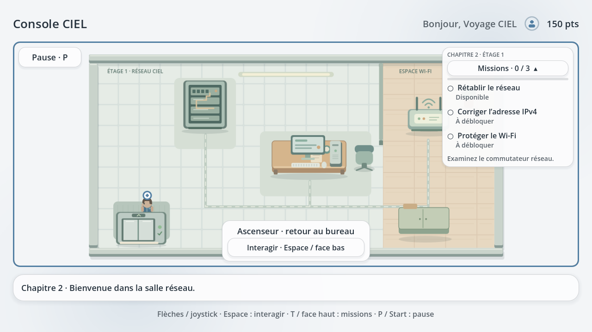

# Enquête éducative — cinq chapitres

Après les cinq chapitres, le récit continue dans **l’hôtel d’en face** : réception, panne informatique, escaliers et chambre 206. Consultez le [guide de l’hôtel 0.11.0](HOTEL.md) pour ce nouveau parcours.

L’enquête propose treize missions : trois défis dans chacun des quatre premiers chapitres et une épreuve mystère dans le cinquième. Chaque première réussite rapporte 50 points ; le total maximal est de 650 points par profil. Un rejeu conserve les récompenses sans les attribuer à nouveau.

## Les livres du chapitre 3

Approchez la petite bibliothèque du **coin ressources**, en bas au milieu de l’atelier code, puis appuyez sur **Espace / bouton de face bas**. Trois couvertures ouvrent les livres **Python**, **HTML** et **Markdown**. Chaque livre contient trois courtes leçons : principes, règles de syntaxe et exemple résolu. Les exemples sont du texte local affiché tel quel.

La couverture sélectionnée s’anime et les pages se déploient à l’ouverture. Les flèches, Entrée et les boutons de la manette permettent de parcourir les pages ; la souris reste utilisable. **Fermer le livre** revient aux couvertures. **Échap / face droit** ferme d’abord le livre, puis le choix des livres. La lecture suspend les déplacements et ne modifie ni points ni progression. Elle reste accessible après les missions. Le réglage « Réduire les animations » désactive ces mouvements.

Les réponses des défis restent saisissables au clavier à l’écran (⇧, 123, symboles, Effacer, Valider) ou au clavier physique : `print`, `h1` et `#`, ou leurs exemples complets. La limite est de 64 caractères par réponse. Les touches P, T et Espace appartiennent au texte lorsque le champ est actif.

## Chapitre 4 — laboratoire réseau

Accessible après les neuf missions précédentes, cet étage propose trois diagnostics guidés :

| Mission | Notion et résultat attendu |
|---|---|
| Pare-feu | Autoriser seulement le poste 192.168.30.20 vers le serveur 192.168.30.10 en TCP 443 (HTTPS), en conservant les autres règles. |
| Conflit IPv4 | Repérer l’adresse .42 partagée par l’imprimante et le terminal ; appliquer .43/24 au terminal selon le plan fourni. |
| Masque réseau | Remplacer le /30 incorrect par 255.255.255.192 (/26) : le poste 192.168.40.70 et la passerelle .65 appartiennent à 192.168.40.64/26. |

Consultez les trois observations de chaque mission, puis choisissez le diagnostic et la correction. Les mauvaises réponses expliquent l’erreur sans retirer de points. Le service revalide les preuves avant une écriture unique de la réussite et de sa récompense. Aucun réglage réseau réel n’est modifié.

## Ascenseur et reprise

Le panneau présente exactement trois boutons : **Descendre d’étage**, **Monter d’étage**, **Retour au menu**. La montée nécessite les trois missions du chapitre courant ; la descente permet de revisiter les étages accessibles. Au rez-de-chaussée, la descente est désactivée ; au chapitre 5, la montée est désactivée. **Échap / face droit** ferme le panneau et laisse le joueur dans la pièce.

Un changement d’étage enregistre d’abord le profil, puis affiche la nouvelle pièce. Si l’écriture échoue, le monde et la sauvegarde restent à l’étage précédent. Continuer reprend l’étage et le point enregistrés. Les profils des anciennes versions à trois, six, neuf ou douze missions sont enrichis sans remise à zéro ; le document d’origine est gardé dans sa sauvegarde .bak lors de la migration.

# Enquête CIEL — trois chapitres

Le joueur commence dans un local technique où une préparation pédagogique a été interrompue. Il rétablit l’éclairage, ouvre le bureau et remet le signal vidéo de l’ordinateur. Après ces trois réussites, l’ascenseur **en bas de la deuxième pièce, le bureau**, se déverrouille et mène à la salle réseau du **chapitre 2**. Après les trois missions réseau, l’ascenseur donne accès à l’atelier du code du **chapitre 3** : Python, HTML et Markdown. Les chapitres précédents sont conservés ; les nouveaux exercices de code proposent une saisie simple au clavier à l’écran, des erreurs expliquées et les mêmes sauvegardes.

Tout se joue hors ligne dans une simulation fictive. Aucun câble réel, terminal, accès Internet ou réglage réseau du PC n’est utilisé ni modifié. Les exercices de code sont des simulations pédagogiques : aucun interpréteur Python ni code saisi par le joueur n’est exécuté.

## Exploration et tableau de missions

Le personnage se déplace en vue du dessus. Les murs, les meubles et les portes fermées bloquent ses déplacements. Un indicateur désigne l’objet proche avec lequel interagir ; un objet dont le prérequis manque explique ce qu’il reste à accomplir. Depuis **0.6.1**, après une réussite sauvegardée, le repère et le bouton d’interaction des objets liés à la mission terminée disparaissent. Les meubles restent visibles dans leur état réparé ; l’ascenseur conserve son interaction pour changer de chapitre. La reprise garde les repères masqués et une nouvelle partie les rétablit pour les missions à refaire, sans redonner les points déjà attribués. Les défis, dialogues et pauses suspendent le déplacement.

Le profil actif, son avatar et ses points sont en haut à gauche de l’écran. Le **tableau de missions** se trouve à droite de l’écran. Replié, il occupe peu de place ; déplié, il montre les trois missions du chapitre courant et leur état **À débloquer**, **Disponible**, **En cours** ou **Terminé**, avec une coche après réussite. Les états ne reposent pas seulement sur la couleur.

En exploration, utiliser son bouton **Afficher / Masquer**, la touche **T**, ou le **bouton de face haut** : Triangle sur PlayStation, Y sur une manette Xbox, X sur une manette Nintendo reconnue avec son mapping standard. **Pause → Afficher les objectifs** donne aussi accès à cette action. Le mapping Godot standard utilise le bouton 3 ; le contrôleur fabriqué doit être mesuré dans **Paramètres → Commandes → Test des commandes** pour confirmer le bouton réellement envoyé.

## Chapitre 1 — le local technique

### Éclairage : fermer une boucle

La simulation représente une source d’énergie en **très basse tension virtuelle**, un interrupteur et une lampe. Elle ne constitue pas un tutoriel de câblage secteur.

Les connexions sont des choix navigables au clavier ou à la manette. Le parcours correct est **source → interrupteur → lampe → retour à la source**. Une boucle incomplète ou une liaison contournant un élément produit une explication et laisse les choix modifiables ; le bouton Valider seul ne suffit pas.

La réussite allume la salle, révèle l’indice de la serrure, termine le premier objectif et sauvegarde la transaction. Une source ne suffit pas : le courant circule ici seulement lorsque le trajet est fermé et correctement relié.

### Serrure : distinguer énergie et commande

Après l’éclairage, consulter les quatre observations : badge reconnu, alimentation correcte, actionneur sans commande et liaison déconnectée. Le diagnostic justifié est **la liaison de commande déconnectée** ; la réparation consiste à **reconnecter la commande** dans la simulation.

Les autres réponses expliquent pourquoi remplacer l’alimentation ou changer de badge ne corrige pas le défaut observé. Après sauvegarde réussie, la porte s’ouvre et sa collision disparaît. Alimenter un appareil et lui transmettre un ordre sont deux fonctions différentes.

### Ordinateur : vérifier avant de conclure

Dans le bureau, l’unité centrale semble démarrer, l’écran est alimenté et affiche **« Aucun signal »**. Consulter ces trois symptômes, vérifier les alimentations et inspecter la liaison vidéo avant d’identifier la cause.

Le câble vidéo virtuel est débranché. Choisir **Câble vidéo débranché**, puis **Rebrancher le câble vidéo virtuel**. Les hypothèses qui ignorent les vérifications ne terminent pas la mission. Le message du local et le bilan du chapitre 1 deviennent disponibles après réussite.

« Aucun signal » ne prouve pas une panne d’alimentation : les observations permettent de suivre le trajet du signal et de justifier le diagnostic.

### Ascenseur vers l’étage

L’ascenseur est visible en bas du bureau. Il reste verrouillé tant qu’une des trois missions du chapitre 1 n’est pas terminée ; l’interaction explique le prérequis sans permettre de monter.

Après le bilan du premier chapitre, reprendre l’exploration, rejoindre l’ascenseur et utiliser **Espace** ou le **bouton de face bas**, puis choisir **Étage 1 · Chapitre 2 · La salle réseau**. Le passage sauvegardé mène à la salle réseau. L’ascenseur de l’étage permet aussi de revenir au **Rez-de-chaussée · Chapitre 1 · Le bureau** sans perdre les réussites. Après les trois missions réseau, un nouveau choix mène au chapitre 3 ; les étages déjà ouverts restent accessibles. Une reprise restaure le chapitre et la salle atteints ; une transition dont la sauvegarde échoue ne doit pas changer de salle.

## Chapitre 2 — la salle réseau

Les prérequis imposent **liaison RJ45 → adressage IPv4 → protection Wi-Fi**. Chaque défi demande de consulter ses trois observations avant de choisir le diagnostic et la correction.

### Liaison Ethernet : commencer par le trajet physique

Le commutateur est alimenté, les autres ports fonctionnent, mais le port du poste affiche **Liaison absente**. Le câble RJ45 virtuel du poste est débranché. Choisir **Câble RJ45 débranché**, puis **Rebrancher le câble RJ45 virtuel**.

Changer le DNS n’explique pas un câble débranché ; remplacer un commutateur dont les autres ports fonctionnent ne traite pas la cause observée. La réussite remet la liaison physique en service et révèle l’indice de l’adressage.

### IPv4 : comparer le poste et sa passerelle

Le poste utilise **192.168.20.42/24** et la passerelle **192.168.10.1/24**. Le masque **255.255.255.0** désigne ici deux sous-réseaux différents. Le plan du local réserve une adresse disponible, **192.168.10.42/24**, à ce poste.

Choisir **Poste dans le mauvais sous-réseau**, puis **Appliquer le plan IPv4 fictif**. Le poste rejoint virtuellement le réseau **192.168.10.0/24** avec la passerelle **192.168.10.1**. Retirer la passerelle ou choisir une adresse au hasard ne suit pas ce plan. Aucun paramètre IPv4 du PC réel n’est changé.

### Wi-Fi : distinguer chiffrement et administration

Le point d’accès fictif annonce un **réseau ouvert sans chiffrement**. Les appareils prennent en charge WPA2/WPA3 et la fiche propose une nouvelle phrase de connexion longue et unique, distincte du mot de passe d’administration.

Choisir **Wi-Fi sans chiffrement**, puis **Activer WPA2/WPA3 et une phrase unique**. Masquer seulement le nom du réseau ne chiffre pas les échanges ; réutiliser le mot de passe administrateur confond deux accès différents. La réussite clôt le chapitre 2 et affiche son bilan pédagogique.

## Chapitre 3 — L’atelier du code

Le clavier AZERTY apparaît dès l’ouverture de chaque exercice. Tapez le mot ou symbole manquant, ou recopiez la ligne complète : `print("Bonjour CIEL")`, `<h1>Bonjour CIEL</h1>` ou `# Bonjour CIEL`. La saisie accepte 64 caractères ; le pseudo garde sa limite de 16. **⇧**, **123**, **#+=**, **Espace** et **Effacer** sont disponibles. **Valider** vérifie la réponse ; **Annuler** revient dans la pièce. Le clavier physique reste utilisable. Les touches P, T et Espace tapent du texte lorsque le champ est actif.

Les trois postes se débloquent dans l’ordre **Python → HTML → Markdown**. Chaque exercice présente une consigne et un petit exemple à compléter, avec des choix utilisables au clavier ou à la manette. Les réponses incorrectes donnent une explication et permettent de réessayer.

### Python : afficher un message

Le poste demande d’afficher un message à l’écran. En Python, la fonction **`print()`** sert à afficher du texte ; les guillemets délimitent le message. Saisir **`print`** pour compléter l’instruction présentée, puis valider la correction proposée. Les parenthèses et les guillemets de l’exemple ne sont pas une commande du système : le jeu valide seulement le choix pédagogique.

### HTML : reconnaître une balise de titre

Le deuxième poste présente un titre principal de page. La balise **`<h1>`** ouvre ce titre et **`</h1>`** le ferme. Saisir **`h1`** pour entourer le texte dans l’exemple. Une balise de paragraphe ou d’image ne répond pas à la consigne du titre principal. Le poste simule le résultat sans ouvrir de navigateur ni charger de page externe.

### Markdown : écrire un titre

Le dernier poste demande un titre de premier niveau. En Markdown, il commence par **`#` suivi d’une espace**, par exemple `# Bonjour CIEL`. Saisir le symbole **`#`**, placé avant l’espace de l’exemple, puis valider. Un tiret commence une liste ; une étoile peut aussi commencer une liste : elle ne crée pas le titre demandé.

L’ascenseur présente les trois destinations : **Rez-de-chaussée · Chapitre 1 · Le bureau**, **Étage 1 · Chapitre 2 · La salle réseau**, et **Étage 2 · Chapitre 3 · L’atelier du code**. La destination actuelle et les destinations encore verrouillées sont indiquées et indisponibles.

La réussite du dernier poste affiche le bilan du chapitre 3. Les repères des trois postes terminés disparaissent, leur décor reste visible et l’ascenseur permet de revenir aux étages débloqués. **Pause → Bilan du chapitre** retrouve le bilan de chaque chapitre terminé.

## Progression, points et anciens profils

Les neuf missions rapportent chacune **50 points à leur première réussite**, soit **150 par chapitre** et **450 au maximum par profil**. Les identifiants de récompense empêchent de recevoir de nouveau ces points en rejouant. Les achats et l’équipement restent conservés lorsqu’une nouvelle partie remet les missions à leur état initial.

Les missions, observations, indices, salle atteinte, checkpoint et gains de la partie sont enregistrés dans le profil actif. Les trois bilans séparent les **nouveaux points gagnés dans cette partie**, cumulés entre les chapitres, du **solde total**, qui peut aussi refléter des achats ou des parties précédentes. Un profil neuf ayant terminé les neuf missions sans achat atteint 450 nouveaux points et un solde de 450.

Les anciens profils reçoivent les objectifs manquants des étages sans perdre leurs anciennes réussites, observations, points, achats ou récompenses. Le schéma de sauvegarde reste en version 1. Un profil ayant déjà terminé le chapitre 2 peut reprendre et accéder au chapitre 3 par l’ascenseur ; ses trois nouvelles récompenses restent à gagner. Chaque profil conserve sa progression propre. Une transition dont la sauvegarde échoue ne change pas de salle. Une fois le chapitre courant terminé, **Pause → Bilan du chapitre** permet de consulter de nouveau ses explications sans réactiver les repères des missions achevées.

Les quatre emplacements Test de la boutique coûtent **200 points chacun**, soit 800 au total. Sans autre dépense, quatre premières réussites permettent un achat ; après neuf réussites, deux achats laissent **50 points**. Un troisième achat est refusé avec ce solde. Les anciens achats restent possédés sans supplément et rejouer ne redonne pas de points.

## Parcours manuel de validation

1. Créer un profil neuf et commencer. Vérifier le profil, l’avatar et les points en haut à gauche. Déplier et replier le panneau par son bouton, **T**, puis le bouton de face haut. Vérifier ses trois objectifs du chapitre 1.
2. Avant chaque réussite, essayer l’objet suivant. L’indice explique le prérequis ; la porte du bureau et l’ascenseur restent bloqués jusqu’aux réussites requises.
3. Soumettre un circuit incomplet, lire l’explication, puis fermer la boucle correcte. Après sauvegarde, vérifier la disparition du repère et du bouton d’interaction de l’éclairage, avec le meuble toujours visible. Quitter et reprendre : lumière et objectif doivent être conservés.
4. Consulter la serrure, essayer une hypothèse erronée, puis réparer la liaison de commande. Dans le bureau, observer l’ordinateur, vérifier alimentation et câble, puis corriger la liaison vidéo. Vérifier après chaque réussite le décor réparé et le repère masqué.
5. Lire le bilan du chapitre 1 : trois objectifs terminés et **150 nouveaux points** pour ce profil neuf. **Pause → Bilan du chapitre** doit être disponible seulement après la troisième réussite. Monter par l’ascenseur en bas du bureau.
6. Dans la salle réseau, essayer l’adressage ou le Wi-Fi trop tôt. Consulter les observations, essayer un diagnostic erroné, puis reconnecter le câble RJ45. Corriger l’adresse selon le plan **192.168.10.42/24**, puis protéger le Wi-Fi avec WPA2/WPA3 et la phrase unique. Lire le bilan de **300 nouveaux points cumulés** sans achat.
7. Vérifier que le chapitre 3 reste inaccessible avant les trois réussites réseau. Rejoindre ensuite l’atelier du code par l’ascenseur. Le panneau doit présenter Python, HTML et Markdown ; chaque poste suivant reste bloqué tant que son prérequis manque.
8. Pour chacun des trois exercices, lire la consigne et soumettre d’abord une mauvaise réponse : explication, mission non terminée et aucun point ajouté. Choisir ensuite **`print`**, **`h1`**, puis **`#`** selon le poste et valider. Après sauvegarde, vérifier le repère masqué et le décor visible. Le troisième bilan affiche **450 nouveaux points cumulés**, neuf missions terminées, sans achat.
9. Vérifier les choix d’ascenseur pour revenir aux chapitres 1 et 2 puis au chapitre 3. Fermer entre les missions et après une transition : **Continuer** restaure le bon étage, les observations, objectifs et points. Tester aussi un ancien profil ayant terminé le chapitre 2 : ses achats et points sont conservés, le chapitre 3 reste à jouer.
10. Avec le profil neuf à 450 points, acheter deux emplacements Test à **200 points** chacun : le solde devient 50 et un troisième achat est refusé. Comparer avec un second profil et reprendre un ancien achat sans supplément. Commencer une nouvelle partie : les repères reviennent ; rejouer les neuf missions ne redonne aucune récompense.
11. Essayer Échap et P avant, pendant et après les défis. Les dialogues empêchent d’interagir derrière eux ; la pause suspend le déplacement. Vérifier le panneau et les choix du code en **1280 × 720, 1024 × 600 et 800 × 480**, texte normal et grand, puis les commandes sans souris.

Les tests automatisés utilisent des dossiers temporaires pour les erreurs d’écriture et la migration. Ne pas corrompre les vrais profils pour reproduire ces cas. L’exécution native, le son et une manette USB physique restent à essayer sur les appareils destinataires. [Recette et résultats de la livraison courante](DELIVERY.md).

## Captures et recette historique 0.6.1

La commande de porte montre le changement demandé : [avant réussite avec repère](screenshots/confort_0.6.1/door_before_success_marker.png), puis [après réussite sans repère ni bouton d’interaction](screenshots/confort_0.6.1/door_after_success_no_marker.png). Le meuble reste dans le décor. Les captures montrent aussi le [chapitre terminé sans repères de missions](screenshots/confort_0.6.1/chapter_completed_no_mission_marker.png) et l’[ascenseur disponible](screenshots/confort_0.6.1/elevator_available_after_missions.png).

La recette **0.6.1 du 14 octobre 2026** a passé **11 844 assertions source** dans 16 suites, **65 de persistance** entre trois processus, **58 contrôles de rendu réel X11** avec 8 captures et **6 547 assertions du pack compilé**, sans échec. Les suites ciblées comptent 137 contrôles des repères terminés et 235 des achats ; le rejeu ne réattribue aucun point. [Résumé historique 0.6.1](../tests/confort_0.6.1_results/summary.json) et [liens des huit captures](DELIVERY.md). Les événements de manette sont virtuels et le son utilise le pilote Dummy ; le pack compilé est testé avec le moteur Linux et le lancement natif Windows reste à vérifier.

## Captures et recette historique 0.6.0

[Ascenseur déverrouillé au bureau](screenshots/chapitre_2_0.6.0/chapter_1_elevator_unlocked.png), [panneau déplié](screenshots/chapitre_2_0.6.0/chapter_2_1280x720_normal_expanded.png), [panneau replié en grand texte](screenshots/chapitre_2_0.6.0/chapter_2_1280x720_large_folded.png) et [les 12 captures](screenshots/chapitre_2_0.6.0/).

La recette sous Godot Linux du **14 octobre 2026** a passé **9 568 assertions source**, **65 de persistance** entre trois processus et **694 contrôles avec rendu X11**, sans échec. Les contrôles ciblés couvrent les prérequis, les six missions, les récompenses uniques, la migration des anciens profils, les erreurs de sauvegarde, les transitions d’ascenseur et les commandes du panneau. [Résumé de la recette](../tests/chapitre_2_0.6.0_results/summary.json). Les périphériques manette sont virtuels et le son des captures utilise le pilote Dummy ; le PC Windows et la console physique restent à vérifier séparément.
## Chapitre 5 — défi mystère

Après les douze premières missions, montez au palier du chapitre 5. Approchez le portable et choisissez **Y aller**. Le personnage arrive à l’entrée d’un labyrinthe fixe de 31 × 23 cases, avec des impasses et une pièce centrale. La caméra suit le joueur ; elle n’affiche pas tout le plan. Les murs visibles et les collisions utilisent la même grille.

Huit inscriptions sont réparties dans les embranchements. Approchez une plaque et interagissez pour lire sa version agrandie. Elles mêlent des indices et des mémos Linux / Windows. Les lire ne valide aucune sous-mission et ne donne aucun point. Le panneau conserve uniquement **???**, avec un compteur de **0 / 1**.

Le terminal central utilise une saisie successive : identifiant, mot de passe, commande, puis authentification des privilèges. Son clavier virtuel reste visible, avec ⇧, 123, symboles, Espace, Effacer et Valider. Le clavier physique reste utilisable ; les mots de passe sont masqués. Une connexion seule ne termine pas l’épreuve. Les commandes sont reconnues par une simulation de texte locale, sans shell, réseau ni exécution système.

Le portail à l’entrée ramène au palier et à l’ascenseur. Fermer le terminal permet de continuer à explorer. Continuer reprend le labyrinthe ; après une connexion enregistrée, le personnage reprend devant le terminal. Une déconnexion de manette conserve la saisie et exige une reprise explicite. Les erreurs de sauvegarde conservent le dernier état enregistré.

Solution de référence pour vérifier le défi

Utilisateur **admin**, mot de passe **admin**, puis **sudo -i** ou **su -** et de nouveau **admin**. Le serveur fictif accepte aussi **sudo**, **sudo -s** et l’abréviation de jeu **s-** ; sudo seul et s- sont des raccourcis pédagogiques propres à cette simulation. `whoami` et `id` permettent d’observer la différence entre admin (uid 1000) et root (uid 0). `dir`, `ipconfig`, `cls` et `runas` ne donnent aucun droit sur ce terminal Linux simulé.

La réussite rapporte **50 points une seule fois**. Les treize missions totalisent 650 points sans achat. Rejouer conserve monnaie et inventaire sans redonner les récompenses. La session de la nouvelle partie est réinitialisée.

## Après le chapitre 5 — cour et second bâtiment (0.10.0)

Une fois le mystère réussi, revenez à l’entrée du labyrinthe, utilisez le portail pour retrouver le palier et prenez l’ascenseur. Choisissez **Descendre d’étage** quatre fois pour revenir au premier niveau de l’enquête, le rez-de-chaussée. Ce niveau possède une **porte de sortie en bas à gauche**. Elle reste fermée tant que le chapitre 5 n’est pas terminé.

Interagissez avec la porte, puis choisissez **Sortir**. Le personnage arrive dans une cour bordée de deux façades ; les flèches au sol indiquent la porte de **l’immeuble d’en face**. Traversez la cour, interagissez avec cette porte et choisissez **Entrer**. Les mêmes portes permettent de revenir au premier bâtiment.

Le second bâtiment est une zone d’exploration de **6 400 × 4 200 pixels**, environ **52 fois la surface** de la première pièce. Seize salles ouvertes sur des galeries entourent un grand atrium. La caméra suit le personnage en restant dans les limites du plan. Les futures missions et le prochain chapitre seront créés plus tard : aucun défi, achat, point ou récompense supplémentaire n’est créé ici.

Une carte native apparaît **en haut à gauche**, sous le bouton Pause. Elle reprend les murs et les portes du plan réel, indique votre position par un point bleu et la sortie par un repère doré. **Un appui sur la flèche droite → affiche ou masque la carte** ; maintenir la touche n’entraîne pas de répétition. Dans ce bâtiment seulement, cette touche ne déplace pas le personnage : utilisez **D**, les autres touches **ZQSD**, ou le joystick. La croix directionnelle de la manette reste disponible pour marcher. Le bouton **Carte** permet aussi de la replier à la souris. La flèche conserve son usage de navigation dans les menus et le fonctionnement des anciens étages.

Chaque passage est validé puis enregistré avant le changement de décor. Un échec d’écriture laisse le joueur dans la zone précédente et permet de réessayer. **Continuer** reprend au seuil d’entrée de la zone sauvegardée, sans réafficher le bilan du chapitre 5 dans le second bâtiment. Les anciens profils, points, achats et observations sont conservés. **Nouvelle partie** remet le parcours au premier chapitre sans redonner les récompenses déjà obtenues.
