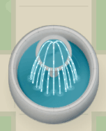

# Salles, lycée et ville — rendu 0.29.0

Les cinq ateliers et le laboratoire réseau conservent leurs portes, missions et géométries physiques. Le mobilier est remplacé par des rendus de modèles originaux créés dans Blender : plateaux en bois, pieds métalliques, sièges rembourrés, claviers, ordinateurs, imprimante 3D, baies, platines de câblage, instruments, tiroirs, banc hydraulique et mezzanine. Les volumes, les biseaux, les matières et les ombres sur les objets proviennent de ces modèles.

La façade reprend le bâtiment bas et asymétrique de Louise Michel : entrée à gauche, aile claire, menuiseries en retrait, volets roulants, poignées, seuils, descentes d’eau, horloge et couvertines. Les photographies de la visite servent de référence et ne sont pas incluses. Le logo déjà fourni conserve ses droits réservés et est ajouté séparément.

Les murs intérieurs restent blancs. Des textures légères donnent une matière aux sols, et des dégradés adoucissent les murs et la lumière des fenêtres. Les ombres de contact au sol restent bornées et progressives pour éviter de voir les rectangles des images. Le personnage a une échelle visuelle adaptée aux meubles des salles ; ses pieds, sa vitesse et son collider restent inchangés. L’échelle extérieure est rétablie en sortant.

Le jeu conserve son fonctionnement 2D : les modèles sont rendus à l’avance. Il n’y a ni visite intégrée, ni serveur d’images, ni calcul 3D permanent pendant le déplacement. Le catalogue relie chaque image à son empreinte physique et à son origine de dessin. Les images Blender utilisent un alpha droit ; les anciens précalculs Godot conservent leur alpha prémultiplié.

Les 23 empreintes de mobilier et la façade sont encodées en WebP sans perte. Le générateur vérifie que chaque pixel visible et chaque valeur alpha restent identiques au rendu PNG. Les sources, les dimensions, les empreintes SHA-256, les versions et le résultat de la vérification sont conservés dans `assets/art/school_realism/manifest.json`. Les dessins originaux sont CC0 ; voir [les licences](../assets/LICENSES.md).

Le CLI `game-dev` du plugin de production n’était pas installé. Les modèles et les rendus ont donc été réalisés directement avec Blender 4.3.2, puis importés et vérifiés avec Godot 4.6.3. Aucun fournisseur payant ni téléchargement de modèle n’a été utilisé. Il ne s’agit pas d’un paquet GLB certifié par ce CLI.

## Régénération

Depuis le dossier `console-ciel`, Blender produit les PNG et leur catalogue :

```bash
blender -b -t 6 --python tools/render_school_assets.py -- --project .
```

Copier ensuite tous les PNG et `manifest.json` de `assets/art/school_realism/` dans un dossier de travail distinct, par exemple `/tmp/ciel-renders`. Encoder les rendus depuis ce dossier :

```bash
godot --headless --path . --script res://tools/pack_school_renders.gd -- --source=/tmp/ciel-renders
godot --headless --path . --import
```

Après la réussite des 24 comparaisons sans perte, conserver les PNG originaux dans le dossier de travail et retirer leurs copies et `.png.import` du projet. Dans les `.webp.import`, conserver `mipmaps/generate=true`, `process/fix_alpha_border=false` et `process/premult_alpha=false`. Régénérer ensuite le catalogue de décors avec un affichage graphique disponible :

```bash
godot --path . --rendering-method gl_compatibility --rendering-driver opengl3_es --script res://tools/bake_static_art.gd
godot --headless --path . --import
godot --headless --path . --script res://tests/school_realism_asset_tests.gd
```

Le jeu doit être contrôlé au niveau des portes, des pieds du mobilier, des contours transparents et du tri du personnage devant et derrière les équipements. Les résultats de livraison et les limites des essais matériels figurent dans [DELIVERY.md](DELIVERY.md).

## Décors de ville

Les **40 bâtiments** ont des objets liés à leur activité. Le catalogue `data/town_forecourts.json` comporte 41 placements : deux drapeaux à la mairie, et un ensemble devant chacun des autres bâtiments. Il comprend le Ritz et le bâtiment A d’origine, ainsi que le lycée isolé. Les bancs de la bibliothèque et de la médiathèque sont conservés. Les terrasses laissent un espace pour les présentoirs ; les portes, chaussées et parcours des passants restent libres.

Les 34 modèles/rendus comprennent notamment le grand panneau à enveloppe et la boîte aux lettres de La Poste ; les pots, pétales, feuilles et arrosoir du fleuriste ; des caisses de fruits, baguettes, machine à café, cloche de restaurant ; le vélo avec rayons, pédales et béquille ; des outils, pneus, bornes, bagages, livres, chevalet, guitare avec cordes et jardinières. Les volumes arrondis et les matériaux sont calculés dans Blender/Cycles. La résolution des images de ville est doublée par rapport aux pixels du monde, avec filtrage et mipmaps. Le jeu reste en 2D et ne calcule pas ces modèles 3D à chaque image.

La fontaine conserve un bassin solide. Ses rebords en pierre, joints, zones humides, vasque et buse sont modélisés dans Blender. Godot anime cinq jets, les gouttes qui accélèrent dans leur chute, onze filets de débordement, les éclaboussures et les ondulations. Il s’agit d’une animation graphique déterministe, sans simulation physique des fluides. La pause et l’option d’animations réduites immobilisent l’ensemble.

Pour régénérer les 34 rendus :

```bash
blender -b -t 6 --python tools/render_town_details.py -- --project .
```

Copier les PNG et `manifest.json` de `assets/art/town_details/` dans un dossier externe, puis lancer :

```bash
godot --headless --path . --script res://tools/pack_school_renders.gd -- --source=/chemin/rendus-ville --destination=res://assets/art/town_details/
```

Retirer les copies PNG après la réussite des comparaisons sans perte, importer les WebP avec les mêmes réglages que ceux du lycée, puis régénérer le cache avec `tools/bake_static_art.gd` et réimporter. Le catalogue conserve les SHA-256 du générateur, des modèles, du placement et du dispositif de rendu. Le budget de tous les décors précalculés, de la façade, de la fontaine et du sol est fixé à 64 Mio RGBA avec mipmaps, après déduplication des textures réutilisées.

Vérifications : `tests/town_details_asset_tests.gd` contrôle les 40 bâtiments, les emprises distinctes, les ressources et les empreintes ; `tests/town_details_ui_tests.gd` contrôle les collisions, les portes, la circulation, les commandes et les pixels de l’eau en rendu natif, y compris en pause et avec les animations réduites.

Rendus capturés dans le logiciel : [La Poste](screenshots/decors_0.29.0/town_details_ui_tests/civic_poste_challenge.webp) · [Fleuriste](screenshots/decors_0.29.0/town_details_ui_tests/civic_fleuriste_challenge.webp) · [Cycles](screenshots/decors_0.29.0/town_details_ui_tests/civic_cycles_challenge.webp) · [Commerces](screenshots/decors_0.29.0/town_details_ui_tests/civic_marche_challenge.webp) · [Musique](screenshots/decors_0.29.0/town_details_ui_tests/civic_musique_challenge.webp).



## Accueil et surveillante — 0.30.0

L’accueil du lycée utilise des murs blancs et le mobilier Blender existant. La surveillante adulte est modélisée localement dans Blender à une échelle de référence d’environ 1,60 m : silhouette fine, cheveux blonds, pull ample opaque et pantalon sombre. La référence de 55 kg guide la silhouette sans simulation de masse. Le fichier `art_sources/surveillante.blend` et le générateur `tools/render_supervisor.py` permettent de reprendre le modèle. Neuf rendus RGBA (repos et huit pas de marche) sont réunis dans un atlas utilisé en jeu, dans le portrait et pendant l’accompagnement. Rendu Cycles CPU 128 échantillons ; aucun modèle externe.

Commande reproductible : `blender -b -t 6 --python tools/render_supervisor.py -- --project . --output /tmp/ciel-supervisor`. La provenance et les empreintes sont dans `assets/art/supervisor/manifest.json`. Le jeu reste en 2D ; Blender n’est pas requis pour jouer.

Le trajet vers les ateliers dure 2,6 secondes et comporte deux plans : escalier droit, puis couloir. La destination est sauvegardée avant le départ, sans résoudre le câblage ni donner de points. Les escaliers circulaires de l’hôtel sont remplacés par des volées droites aux mêmes emplacements. Les grandes pancartes extérieures du lycée sont retirées ; le petit logo de façade est conservé.

## Correction des postes et du couloir — 0.31.0

Les écrans des postes fixes possèdent des dalles agrandies et des pieds plus hauts. La tour, le clavier et la souris sont séparés. Le modèle original est régénéré avec Blender/Cycles et compressé sans perte. Le couloir conserve une porte vers City CIEL, sans panneaux ni textes au sol. Les anciennes salles et leurs sauvegardes sont conservées, mais leurs portes ne sont plus présentées dans ce couloir. Le retour vers l’accueil reste disponible à proximité de l’arrivée.

## Personnage 3D et gabarit fixe — 0.32.0

Le joueur devient un modèle 3D articulé, modélisé dans Blender et exporté en GLB avec un squelette commun et les animations de repos et de marche. Le configurateur utilise une caméra 3D et permet le teint, les yeux, les lèvres, le sourire, les cheveux et le dressing. Les casquettes utilisent des formes originales sans marque ni logo. Les 37 groupes de maillages sont sélectionnés selon l’apparence ; la combinaison la plus détaillée représente 22 748 triangles. Les matériaux sont réutilisés dans chaque personnage. Les mini-vues de jeu utilisent un viewport 128 × 192, les aperçus 384 × 512. Une vue immobile ne dessine qu’à la demande.

Depuis la version 0.34.0, seule la marche naturelle est utilisée, même pour les profils ayant enregistré l’ancienne démarche bancale. Les animations réduites restent disponibles. Les collisions 2D gardent leur rayon de 10 unités ; le personnage 3D jouable utilise une capsule constante de 1,70 m × 0,46 m. Aucun vêtement ni coiffure ne change ces formes. L’espace Marcher en 3D sert à essayer cette capsule. Les niveaux de l’enquête restent en 2D pendant cette première étape de migration. Le rendu vise un personnage stylisé, pas un humain photographique.

Régénérer les sources : `blender -b -t 6 --python tools/build_character_3d.py -- --project .`. Les sources Blender sont incluses dans les nouveaux projets complets. Aucun service payant n’est requis. La disponibilité des achats est validée à la lecture et à chaque enregistrement ; les anciens profils restent compatibles sans réécriture forcée.

## Matières et boutique — 0.33.0

Huit cartes périodiques originales apportent couleur de détail, relief et rugosité : peau, coton, maille, denim, cuir, feutre, paille et cheveux. Le shader projette les textures sur trois axes, sans modifier le maillage ni nécessiter des UV supplémentaires. Le relief cutané reste discret et la brillance est réduite ; les tissus présentent des fils, la maille des points et le cuir un grain. Les cartes filtrées avec mipmaps représentent moins de 1 Mio RGBA avec mipmaps. Leur code de génération, licence CC0 et empreintes sont conservés dans `assets/character3d/materials/manifest.json`. Aucun service externe n’est utilisé.

La boutique possède un catalogue de vêtements et accessoires avec trente vignettes précalculées depuis le vrai modèle. Une seule vue 3D affiche l’essayage de l’article sélectionné. Recherche, catégories, filtres gratuits/mon dressing et choix de couleur précèdent l’achat. Les articles acquis ne sont équipés qu’après une action explicite. Les sauvegardes, l’inventaire et les contrôles clavier/manette utilisent les services existants. Le modèle, les gabarits et les démarches ne sont pas modifiés.

Régénération des cartes : `python tools/generate_character_materials.py`. Conserver les fichiers `.import` fournis, puis importer le projet Godot. Régénération des vignettes avec un affichage OpenGL disponible : `godot --path . --script res://tools/bake_wardrobe_thumbnails.gd`. Les sources Blender restent celles de la version 0.32.0.

## Marche naturelle — 0.34.0

Le balancement procédural cumulait les rotations sur les pistes constantes du GLB : après des échantillonnages répétés, le bassin tournait et le personnage se couchait. Ce balancement est supprimé. Chaque pose réinitialise le squelette avant de lire le cycle de marche ou le repos ; les positions et rotations utilisées pour s’asseoir viennent de cet échantillon, sans addition au résultat précédent. Les arrêts et le passage assis/debout retrouvent donc une pose stable.

Les nouveaux personnages utilisent `natural`. La valeur historique `loose` reste valide à la lecture des sauvegardes ; le service renvoie une copie utilisant la marche naturelle, sans écrire sur le disque ni modifier la tenue, les achats ou les points. Le configurateur ne propose plus l’ancienne démarche. Le modèle, les matières et les formes de collision restent identiques.

La régression `tests/character_movement_tests.gd` répète le même instant 1 200 fois puis simule 60 secondes de marche dans huit directions pour chaque valeur historique. Elle contrôle la verticalité, les arrêts, l’alternance des jambes et les transitions assises. Le parcours natif teste aussi les événements clavier et joystick simulés dans le jeu, ainsi que le passage de porte du personnage 3D.

[Voir le cycle de marche naturelle capturé dans Godot](screenshots/marche_0.34.0/marche_naturelle.gif) · [Captures du jeu et du configurateur](screenshots/marche_0.34.0/character_ui_tests/).

## Anatomie et couture — 0.35.0

Le modèle original est repris dans Blender : volumes de bassin, taille et thorax, membres effilés avec coudes et genoux, paumes et doigts séparés, joues, mâchoire, nez et paupières. Les vêtements suivent ces volumes ; les épaules sont inclinées, les pantalons ont un bassin continu, une ceinture et des coutures. Les tissus recouvrent la peau selon leur coupe afin de limiter les traversées. Le squelette, sa marche corrigée et les collisions restent à dimensions fixes. Budget visible inférieur à 40 000 triangles, contre 25 000 dans la première version plus simple.

La tenue Madison interprète la référence fournie : robe à bandeau replié gris cendré, manches séparées avec rubans, collants noirs, chignon relevé avec mèches et escarpins à brides. La robe inclut visuellement les collants noirs. Le preset utilise trois achats existants en points : robe 120, chignon 45, chaussures 65. Des collants séparés à 30 points sont aussi disponibles. Le modèle est original et stylisé ; il ne constitue pas un scan photoréaliste ni un asset officiel. Aucune marque ou logo n’est dessiné sur la tenue.

Sources : `tools/build_character_3d.py` et `art_sources/character_modular.blend`. Blender 4.3.2 produit le GLB et le manifeste d’empreintes ; Godot 4.6.3 recalcule les 34 vignettes de boutique. Le CLI game-dev du plugin est absent de cet environnement : génération, inspection et validation sont effectuées avec Blender, Godot et les outils locaux. Aucun prestataire payant utilisé.

[Tenue en mouvement dans Godot](screenshots/couture_0.35.0/tenue_madison_marche.gif) · [Portrait, vues de face, de dos et boutique](screenshots/couture_0.35.0/couture_ui_tests/).

## Parcours en vraie 3D — 0.36.0

Le quartier, l’accueil et l’atelier disposent maintenant d’un parcours 3D distinct, avec le personnage du dressing, des collisions et des interactions. Voir [les sources, commandes et limites](CAMPUS_3D.md). Les sections précédentes décrivent les décors historiques de l’enquête.
