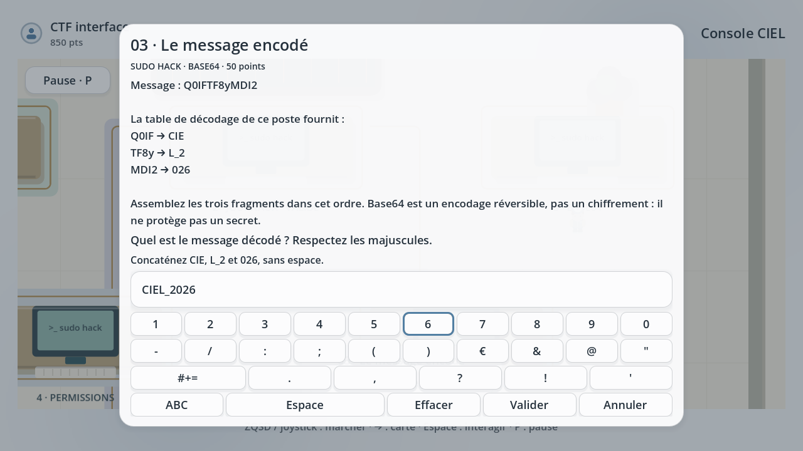
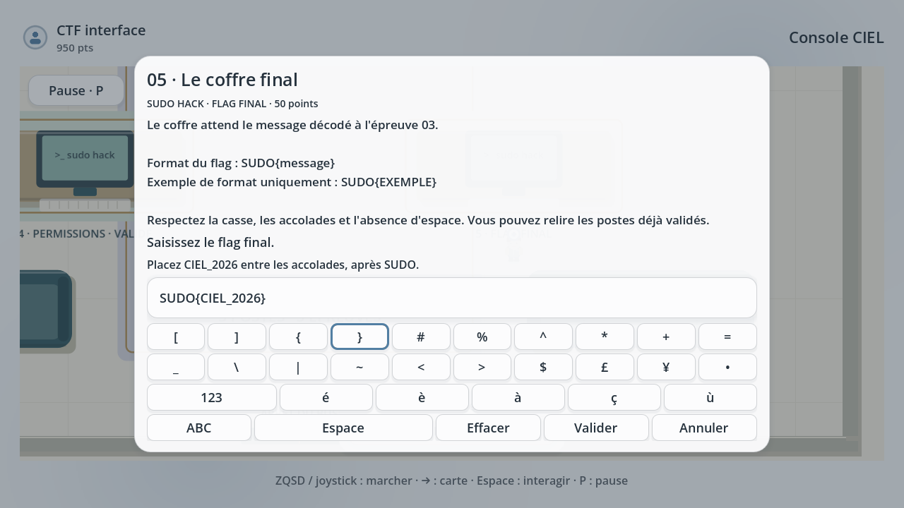

# Console CIEL — toutes les solutions

**Version 0.19.0.** Cette fiche donne volontairement les bonnes réponses. Elle suit l’ordre du jeu, du premier bâtiment au retour du CTF. Les commandes et identifiants concernent uniquement les simulations de Console CIEL.

## Avant de commencer

Approchez-vous d’un objet puis appuyez sur **Espace** ou la **touche basse de la manette**. **Échap / touche droite** ferme un panneau. **T / touche haute** affiche les missions. À l’hôtel et au CTF, **→** affiche la carte ; marchez avec **ZQSD ou le joystick**. Dans les saisies, le clavier virtuel propose **Maj**, **123** et les symboles.

Pour les diagnostics, consultez **toutes les observations** avant de choisir la cause et la réparation. Chaque mission éducative et chaque poste CTF rapporte **50 points une seule fois par profil**. Les achats et pénalités diminuent le solde ; les nouvelles récompenses remboursent d’abord une dette éventuelle.

## Chapitre 1 — atelier et bureau

| Épreuve | Bonne réponse / action |
|---|---|
| Éclairage | Relier **source → interrupteur**, **interrupteur → lampe**, puis **lampe → retour**. Valider les trois connexions. |
| Porte | Lire les quatre observations. Choisir la **liaison de commande déconnectée**, puis **Reconnecter la commande**. Le badge est reconnu et l’alimentation fonctionne déjà. |
| Ordinateur | Lire les observations et effectuer les vérifications **alimentation** et **vidéo**. Cause : **Câble vidéo débranché**. Correction : **Rebrancher le câble vidéo virtuel**. |

Les trois réussites ouvrent l’ascenseur en bas du bureau. Monter d’un étage pour le chapitre 2.

## Chapitre 2 — réseau

| Épreuve | Cause | Réparation |
|---|---|---|
| Liaison Ethernet | Câble RJ45 débranché | Rebrancher le câble RJ45. |
| Adressage IPv4 | Poste dans le mauvais sous-réseau | Choisir **Appliquer le plan IPv4 fictif** : **192.168.10.42/24**, masque **255.255.255.0**, passerelle **192.168.10.1**. |
| Protection Wi-Fi | Réseau ouvert, sans chiffrement | Activer **WPA2/WPA3** avec une **phrase longue et unique**. |

Consulter les trois observations de chaque poste. Terminer les trois épreuves puis monter à l’atelier du code.

## Chapitre 3 — Python, HTML et Markdown

Le coin ressources contient trois livres ; leurs leçons donnent aussi les réponses.

| Poste | Saisie la plus courte | Exemple complet |
|---|---|---|
| Python | `print` | `print("Bonjour CIEL")` |
| HTML | `h1` | `<h1>Bonjour CIEL</h1>` |
| Markdown | `#` | `# Bonjour CIEL` |

Utiliser la page des symboles pour `#`. Valider chaque réponse, puis monter au laboratoire réseau.

## Chapitre 4 — pare-feu, IPv4 et masque

| Épreuve | Diagnostic | Bonne correction |
|---|---|---|
| Pare-feu | Règle HTTPS manquante | Autoriser **192.168.30.20 → 192.168.30.10, TCP 443 uniquement**. |
| Conflit IPv4 | Deux équipements utilisent la même IPv4 | Donner **192.168.30.43/24 au terminal**, garder **.42 pour l’imprimante** et la passerelle **192.168.30.1**. |
| Masque | Le poste est en **/30 au lieu de /26** | Appliquer **255.255.255.192 (/26)**. Le poste **192.168.40.70** et la passerelle **192.168.40.65** appartiennent alors à **192.168.40.64/26**. |

Lire les trois observations de chaque poste, valider les corrections, puis monter au chapitre mystère.

## Chapitre 5 — le labyrinthe et le terminal

1. Interagir avec le portable et choisir **Y aller**.
2. Explorer le labyrinthe jusqu’au terminal central. Les inscriptions donnent des indices et des fausses pistes.
3. Interagir avec le terminal et saisir l’identifiant **`admin`**, puis le mot de passe **`admin`**.
4. Saisir **`sudo -i`** (ou **`su -`**), valider puis saisir de nouveau **`admin`** à la demande du mot de passe.
5. La session **root** valide l’unique mission `???`.

Après la réussite, le panneau **Retourner au début du labyrinthe** permet de rejoindre son entrée sans perdre la validation ni les points. **Continuer à explorer** permet de rester au terminal. Quitter ensuite le labyrinthe par son point de retour, puis descendre **un étage à la fois** jusqu’au rez-de-chaussée. Interagir avec la porte de sortie en bas à gauche.

## La ville — passage piéton

Attendre le **feu piéton vert**, puis traverser sur les bandes pour rejoindre l’hôtel d’en face. Une traversée commencée au rouge et terminée sans collision coûte **200 points**. Une collision ramène au trottoir de départ et conserve la progression.

## Hôtel CIEL — réservation et panne

1. À la réception, **réserver la chambre 206**.
2. Rejoindre la porte du local informatique à côté du hall.
3. Consulter les quatre observations : **alimentation, réseau, espace disque, service**.
4. Diagnostic : **disque plein**. Réparation : **archiver les anciens journaux pour libérer de l’espace, puis redémarrer le service de réservation**.
5. Revenir au hall et monter par les escaliers. Le **premier étage est fermé**, mais ses escaliers permettent de continuer vers l’étage 2.
6. Entrer **chambre 206**, poser les affaires et interagir avec le lit. Choisir **Dormir**. Si l’on choisit de s’asseoir, il faut finalement choisir Dormir dans les choix qui reviennent toutes les dix secondes.

## Le lendemain — petit déjeuner et café

Descendre au **rez-de-chaussée** : **+50 points** à la première arrivée. Entrer dans la salle du petit déjeuner et s’asseoir à la table. Interagir ensuite avec la machine à café.

| Borne du haut | Borne du bas | Couleur |
|---|---|---|
| **A** | **3** | Rouge |
| **B** | **2** | Vert |
| **C** | **1** | Marron |

Choisir une borne puis sa correspondante. La borne sélectionnée brille ; un nouvel appui la désélectionne. Après les trois paires, **prendre le café**. Remonter **chambre 206**, récupérer **le sac et l’ordinateur** : **+50 points** à la première récupération. Redescendre et sortir vers l’arrêt de bus pour Sudo Hack.

## CTF Sudo Hack — cinq épreuves

Les postes se débloquent dans l’ordre. Lire les indices, saisir la réponse puis choisir **Valider**. Chaque réponse ci-dessous peut être entrée au clavier physique ou avec le clavier à l’écran.

| Poste | Réponse exacte à saisir | Pourquoi |
|---|---|---|
| **1 · Le faux message** | `sudo-hack-support.example` | C’est le domaine suspect, différent du domaine officiel `sudo-hack.example`. |
| **2 · La piste des journaux** | `192.0.2.42` | Cette adresse apparaît sur les trois lignes `FAILED`. |
| **3 · Le message encodé** | `CIEL_2026` | Décodage de `Q0lFTF8yMDI2` ; respecter les majuscules et le tiret bas. |
| **4 · Le fichier privé** | `chmod 600 secret.txt` | Propriétaire : lecture + écriture ; groupe et autres : aucun droit. |
| **5 · Le coffre final** | `SUDO{CIEL_2026}` | Mettre le message du poste 3 entre les accolades du format demandé. |

Les domaines `.example` et les adresses `192.0.2.x` sont des exemples fictifs. Aucune commande saisie sur ces postes n’agit sur l’ordinateur réel. Base64 n’est pas un chiffrement.

Les trois premiers postes sont en haut du hall, de gauche à droite. Les deux derniers sont en dessous. Les postes validés restent consultables pour relire leurs indices.

## Retour en ville et points

Après **5 / 5**, sortir par la porte en bas du hall. Interagir avec l’**arrêt de bus devant Sudo Hack** puis choisir **Revenir en ville**. Le joueur revient sur le trottoir, près de l’arrêt desservant l’hôtel. Les bâtiments, l’hôtel et les postes terminés restent accessibles. Le trajet ne donne aucun point.

Sans achat ni pénalité : **650 points** pour les treize missions éducatives, **100 points** pour le matin à l’hôtel et **250 points** pour Sudo Hack, soit **1 000 points**. Rejouer une mission, prendre le bus ou recommencer une partie ne redonne pas les récompenses déjà reçues.

Le profil **Dev · Super administrateur** créé en 0.18.0 possède aussi les cinq postes du CTF validés. Un ancien Dev conserve son solde : réinitialiser son parcours ajoute les nouvelles validations sans lui ajouter de points.

[Revenir au projet](../console-ciel/README.md)

Les commandes réservées au profil Dev sont regroupées dans le fichier **commandes triches.md**, dans ce même dossier. [Ouvrir la fiche](https://github.com/loghanmrsn/Console-logiciel/blob/main/solution/commandes%20triches.md).

Le bus devant Sudo Hack permet aussi de rentrer en ville avant la fin des cinq épreuves. Les réponses validées et les points restent conservés. Reprenez le bus près de l’hôtel pour poursuivre le CTF.

## Lycée — porte de l’atelier (0.22.0)

Depuis la salle cyber, prenez l’accès au couloir. Interagissez avec la porte à droite et reliez **A–3 (rouge), B–2 (vert), C–1 (marron)**. Sélectionnez une borne du haut puis la borne du bas ; un second appui sur la borne du haut annule sa sélection. Une mauvaise paire est refusée. Chaque connexion correcte est sauvegardée ; la porte reste déverrouillée.

Choisissez **Y aller**, suivez le long couloir et prenez la porte à gauche signalée « Atelier · 10 m ». La visite de l’atelier n’ajoute pas de points et ne réinitialise aucune mission. Le retour par les mêmes portes est possible.
